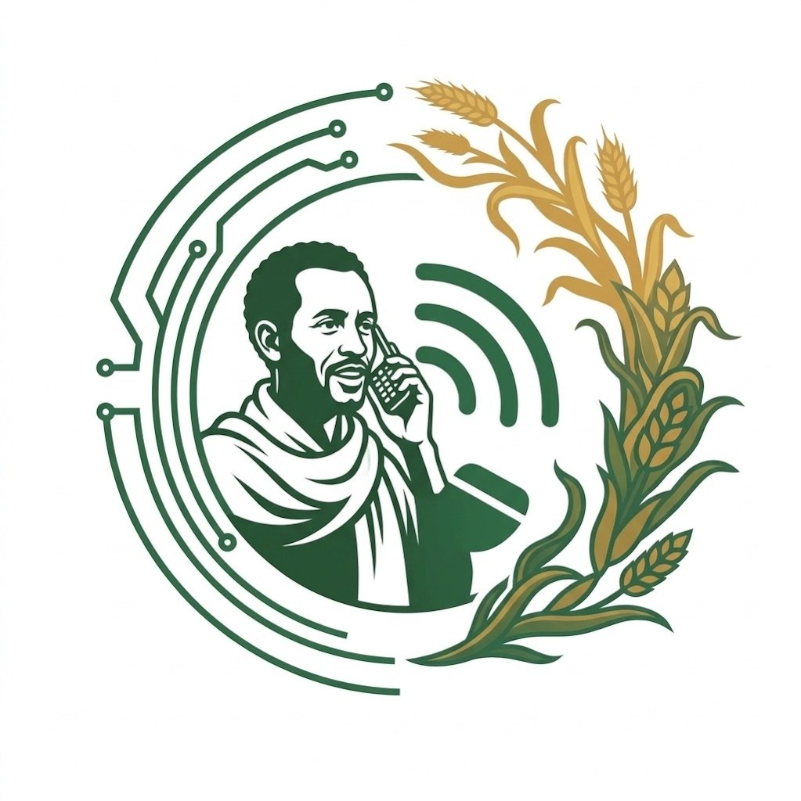
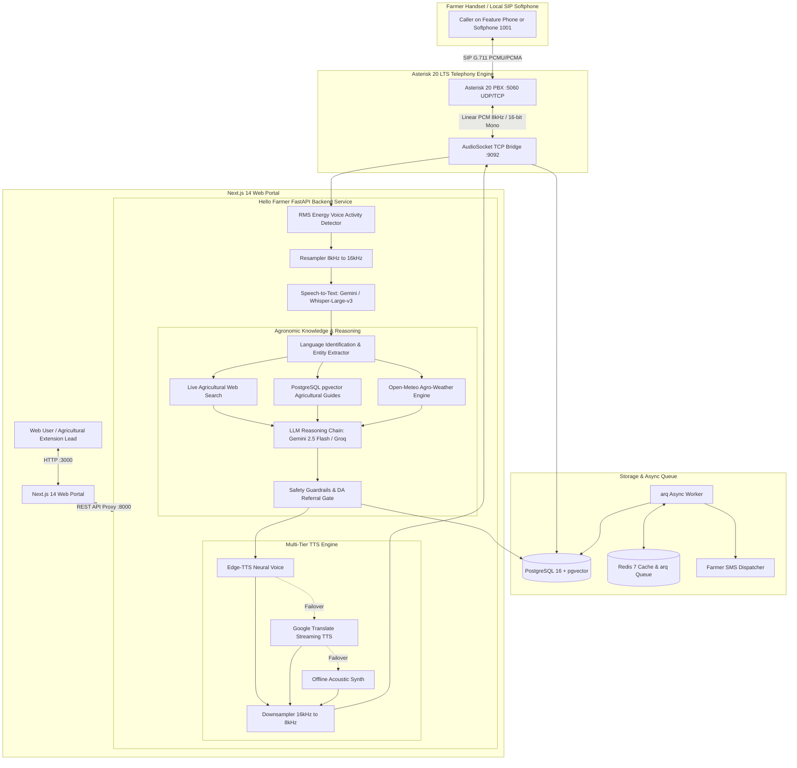

<div align="center">

# 🌾 Hello Farmer | ሄሎ ፋርመር

### AI-Powered Conversational Agricultural Voice & Web Intelligence Platform for Ethiopian Smallholder Farmers

<p align="center">
  <b>አማርኛ</b> • <b>Afaan Oromoo</b> • <b>English</b>
</p>

[](https://opensource.org/licenses/MIT)
[](https://www.python.org/)
[](https://fastapi.tiangolo.com/)
[](https://nextjs.org/)
[](https://www.asterisk.org/)
[](https://github.com/pgvector/pgvector)
[](https://redis.io/)
[](https://www.docker.com/)

<br />



<br /><br />

*Empowering Ethiopian smallholders, youth agronomists, and development agents with instant, scientifically verified agricultural guidance through natural voice phone calls on basic feature phones (**8028 Hotline**) and an intelligent, responsive web decision platform.*

<br />

[Explore Features](#-key-features) • [System Architecture](#-system-architecture) • [Quickstart Guide](#-quickstart--installation) • [Telephony Setup](#-voice-agent--telephony-testing) • [API Reference](#-api-documentation) • [Agronomic Safety](#-agricultural-safety-guardrails)

</div>

---

## 📖 Executive Summary

Agriculture accounts for over **80% of employment** and livelihood generation across Ethiopia. Yet, millions of rural smallholders face structural barriers: low digital literacy, lack of smartphone or internet access, shortage of local agricultural Development Agents (DAs), and devastating, time-critical crop threats like **Yellow Rust (*Puccinia striiformis*)** and **Fall Armyworm (*Spodoptera frugiperda*)**.

**Hello Farmer (ሄሎ ፋርመር)** introduces a high-availability, dual-channel agricultural intelligence ecosystem:

1. **Voice Telephone Hotline (8028)**: Designed for rural farmers using standard 2G feature phones without internet. Farmers dial **8028**, speak naturally in **Amharic (አማርኛ)** or **Afaan Oromoo** without navigating confusing numeric keypad menus, and receive immediate, spoken agricultural advice grounded in official manuals and live agricultural search.
2. **Modern Web Portal (`http://localhost:3000`)**: A comprehensive dashboard for extension workers, cooperative managers, and commercial farm leads featuring interactive AI advisory, real-time agro-meteorological forecasting with chemical spraying risk evaluations, crop yield estimators, live telephony status, and auditable call logs.

---

## 🌟 Key Features

### 🎙️ Dual-Channel Voice & Web Advisory
* **No Internet or Smartphone Required**: Operates over standard telephone lines through Asterisk 20 PBX and AudioSocket audio streaming.
* **Native Bilingual Dialogue**: Real-time speech recognition and synthesis in **Amharic** and **Afaan Oromoo**, writing numbers as words and honoring local agricultural terminology.
* **Continuous Multi-Turn Dialogue**: Retains conversational context across speaking turns with automatic silence detection (Energy VAD).

### 🧠 Grounded Hybrid RAG & Live Agronomic Search
* **Vetted Knowledge Base**: Indexed in PostgreSQL `pgvector` with 768-dimensional embeddings over official Ethiopian Ministry of Agriculture (MoA), EIAR, and FAO technical manuals.
* **Live Agricultural Web Search Prioritization**: Dynamically queries trusted agricultural resources in real-time, injecting fresh advisory context and persisting discovered web passages back into pgvector for future retrieval.

### 🛡️ Rigorous Agricultural Safety Guardrails
* **Zero-Hallucination Chemical Policy**: Pesticide, fungicide, and herbicide dosage rates are strictly restricted to verified Tier 1 sources.
* **Mandatory Development Agent Referral**: Unverified diagnoses or out-of-bounds questions trigger automated, empathetic referrals to local Kebele Development Agents.
* **Spoken Tone & Brevity**: Answers are capped at 3 concise, spoken sentences (35–45 words) tailored for clear audio playback over telephone speakers.

### 🌦️ Agro-Meteorological & Chemical Spraying Risk Engine
* **18 Agricultural Hubs Covered**: Real-time weather forecasting for key Ethiopian farming zones (Adama, Bako, Hawassa, Debre Zeit, Jimma, Bahir Dar, Debre Birhan, Mekelle, Assosa, Dire Dawa, etc.).
* **Smart Spraying Hazard Assessment**: Evaluates rain wash-off danger (precipitation >= 20 mm), wind drift hazard (wind >= 15 km/h), and temperature extremes before chemical applications.

### 🔊 Resilient Multi-Tier Text-to-Speech (TTS)
* **Tier 1 (Primary)**: High-fidelity neural speech via Edge-TTS (`am-ET-MekdesNeural`, `am-ET-AmehaNeural`).
* **Tier 2 (Fallback)**: Resilient chunked streaming via Google Translate TTS with punctuation-aware segmentation.
* **Tier 3 (Acoustic)**: Deterministic acoustic synthesizer fallback ensuring calls never mute or hang up unexpectedly.

### 📊 Real-Time Analytics & Database Persistence
* **PostgreSQL Session Logging**: Persists call start times, duration, caller hash, dialogue turns, and outcome classifications (`completed`, `timeout`, `max_silence`, `error`).
* **Interactive Web Analytics**: Aggregates daily call trends, 24-hour activity heatmaps, language breakdowns, and agricultural topic inquiry distributions.

---

## 🏗️ System Architecture

### End-to-End Conversational Telephony Pipeline



---

## 🛠️ Technology Stack

| Layer | Technology | Version | Purpose |
| :--- | :--- | :---: | :--- |
| **Telephony Gateway** | Asterisk PBX | 20 LTS | SIP signaling, RTP media handling, AudioSocket TCP bridging. |
| **Audio Transport** | AudioSocket Protocol | RFC 4122 | Bidirectional 8 kHz linear PCM streaming between Asterisk and Python. |
| **Backend Framework** | FastAPI (Python) | 3.11+ | Asynchronous REST APIs, AudioSocket server, background pipelines. |
| **Speech-to-Text (STT)** | Google Gemini / Groq Whisper | Multimodal | High-accuracy Amharic and Afaan Oromo speech recognition. |
| **Vector Database** | PostgreSQL + pgvector | 16 / 0.8.7 | Unified ACID storage for 768-dim embeddings, call records, and farmer profiles. |
| **In-Memory Cache & Queue**| Redis | 7-Alpine | 60-minute weather cache TTL, rate limiting, and `arq` background queue. |
| **LLM Reasoning** | Gemini 2.5 Flash / Groq Qwen | Production | Structured agricultural advice generation with strict JSON schema. |
| **Text-to-Speech (TTS)** | Edge-TTS + Google TTS | Multi-Tier | Neural speech synthesis with automatic resilient fallback. |
| **Web Frontend** | Next.js (App Router) | 14.2 | Full-featured responsive React portal with localized interfaces. |
| **Agro-Weather API** | Open-Meteo API | Free Tier | Real-time precipitation, temperature, humidity, and wind speed. |
| **Containerization** | Docker & Docker Compose | Multi-Arch | Complete 6-service orchestrated stack. |

---

## 📂 Project Directory Structure

```text
Hello_farmer/
├── .env.example                  # Environment configuration template
├── config.yaml                   # Central project thresholds and fallback prompts
├── docker-compose.yml            # 6-container production orchestration specification
├── Makefile                      # Developer shortcuts (make up, make test, make lint)
├── pyproject.toml                # Formatting and testing configurations (Ruff, Pytest)
│
├── asterisk/                     # Asterisk 20 LTS Telephony Service
│   ├── Dockerfile                # Custom Asterisk image with AudioSocket application
│   ├── pjsip.conf                # PJSIP endpoint, transport, and authentication configuration
│   ├── extensions.conf           # Dialplan routing 8028 calls to AudioSocket :9092
│   ├── modules.conf              # Asterisk module loading definitions
│   └── rtp.conf                  # RTP port allocation range (10000-10020)
│
├── backend/                      # Core FastAPI Application & Audio Bridge
│   ├── Dockerfile                # Python 3.11 container with ffmpeg and audio toolchains
│   ├── requirements.txt          # Production dependencies
│   ├── cache/prompts/            # Fixed pre-rendered 8 kHz PCM telephony WAV files
│   └── app/
│       ├── main.py               # REST API endpoints (Voice Status, Calls, Weather, Stats)
│       ├── pipeline.py           # Core process_utterance conversational pipeline
│       ├── config.py             # Pydantic Settings and environment validation
│       ├── telephony/            # AudioSocketServer, VAD endpointer, CallStateMachine
│       ├── rag/                  # pgvector store, live web search, passage persistence
│       ├── llm/                  # System prompts v2.0, JSON schemas, Groq/Gemini fallbacks
│       ├── safety/               # Agricultural safety guardrails and DA referral triggers
│       ├── tts/                  # Multi-tier TTS (EdgeTTS, Google TTS, acoustic synth)
│       ├── stt/                  # Speech-to-text providers (Gemini, Whisper)
│       ├── weather/              # Open-Meteo client, Ethiopian hubs, spraying risk analyzer
│       ├── database/             # SQLAlchemy async models, session factories, seed scripts
│       └── sms/                  # arq background worker advice summarization & SMS
│
├── frontend/                     # Next.js 14 React Web Portal
│   ├── Dockerfile                # Node.js production image
│   ├── package.json              # NPM dependencies (React, Lucide, Next.js)
│   ├── public/                   # Official logo and static graphics
│   └── app/
│       ├── page.tsx              # Integrated dashboard view (Advisor, Voice, Weather, Stats)
│       ├── layout.tsx            # HTML document wrapper with metadata
│       ├── globals.css           # Design tokens, emerald-harvest themes, and CSS utilities
│       └── i18n/translations.ts  # Complete bilingual localization dictionaries
│
├── knowledge_base/               # Vetted Agronomic Corpus
│   ├── SOURCES.md                # Provenance and tier definitions of ingested manuals
│   └── raw/                      # Official MoA, EIAR, and FAO extension manuals
│
├── scripts/                      # Developer CLI Utilities
│   ├── ingest_kb.py              # Ingests raw agronomic guides into pgvector PostgreSQL
│   ├── render_prompts.py         # Renders fixed studio prompt WAVs for telephony
│   ├── test_pipeline.py          # End-to-end CLI pipeline test runner
│   ├── test_stt.py               # Audio transcription accuracy benchmark
│   └── test_groq_llm.py          # Low-latency LLM generation benchmark
│
└── tests/                        # Comprehensive Pytest Suite
    ├── test_basic.py             # Environment sanity checks
    ├── test_llm_guardrails.py    # Chemical dosage guardrail verification tests
    ├── test_rag.py               # Vector similarity search tests
    ├── test_telephony.py         # AudioSocket framing and state machine tests
    └── test_weather.py           # Spraying hazard and rain wash-off tests
```

---

## 🚀 Quickstart & Installation

### Option A: Complete Containerized Stack with Docker Compose (Recommended)

This single command launches all 6 microservices: FastAPI Backend, Next.js Frontend, Asterisk 20 PBX, PostgreSQL with pgvector, Redis, and the background worker.

#### 1. Clone the Repository
```bash
git clone https://github.com/YEAB-G/Hello-Farmer.git
cd Hello-Farmer
```

#### 2. Configure Environment Variables
```bash
# On Windows PowerShell:
Copy-Item .env.example .env

# On Linux / macOS:
cp .env.example .env
```

Open `.env` and configure your API keys:
```ini
GEMINI_API_KEY=AIzaSyYourActualKeyHere
# Optional: GROQ_API_KEY=gsk_...
```

#### 3. Start All Services
```bash
docker compose up --build -d
```

#### 4. Confirm Container Health
```bash
docker compose ps
```

All 6 services will be listed as `healthy`:
```text
NAME                     STATUS              PORTS
hello_farmer_asterisk    Up (healthy)        0.0.0.0:5060->5060/udp, 0.0.0.0:5060->5060/tcp
hello_farmer_backend     Up (healthy)        0.0.0.0:8000->8000/tcp, 0.0.0.0:9092->9092/tcp
hello_farmer_frontend    Up (healthy)        0.0.0.0:3000->3000/tcp
hello_farmer_postgres    Up (healthy)        0.0.0.0:5432->5432/tcp
hello_farmer_redis       Up (healthy)        0.0.0.0:6379->6379/tcp
hello_farmer_worker      Up (healthy)        
```

#### 5. Ingest the Agricultural Knowledge Base
```bash
docker exec hello_farmer_backend python scripts/ingest_kb.py
```

#### 6. Open the Web Application
* **Web Portal**: [http://localhost:3000](http://localhost:3000)
* **Interactive API Documentation (Swagger)**: [http://localhost:8000/docs](http://localhost:8000/docs)
* **System Health Endpoint**: [http://localhost:8000/api/v1/health](http://localhost:8000/api/v1/health)

---

### Option B: Local Hybrid Development

Run database and telephony services inside Docker, while developing the Python backend and Next.js frontend directly on your host machine:

```bash
# 1. Start core infrastructure containers
docker compose up -d postgres redis asterisk

# 2. Run backend locally
python -m venv .venv
.venv\Scripts\Activate.ps1   # Linux/macOS: source .venv/bin/activate
pip install -r backend/requirements.txt
python -m uvicorn backend.app.main:app --host 0.0.0.0 --port 8000 --reload

# 3. Run frontend locally in a separate terminal
cd frontend
npm install
npm run dev
```

---

## 📞 Voice Agent & Telephony Testing

### 1. Testing with a Softphone (MicroSIP / Linphone)

The stack comes ready out of the box with extension accounts defined in `asterisk/pjsip.conf`.

#### Step 1: Download & Install MicroSIP
Download [MicroSIP](https://www.microsip.org/) (Windows) or [Linphone](https://www.linphone.org/) (macOS/Linux/Android).

#### Step 2: Configure Account Credentials
In MicroSIP, click **Add Account...** and set:
* **Account Name**: `Hello Farmer Caller`
* **SIP Server**: `127.0.0.1:5060` *(or your host PC's Wi-Fi LAN IP to call from a laptop/phone)*
* **Username**: `1001`
* **Domain**: `127.0.0.1` *(or your LAN IP)*
* **Password**: `FarmerPass1001!`
* **Audio Codecs**: Ensure `G.711 u-law (PCMU)` or `G.711 a-law (PCMA)` is enabled.

*(Note: Extension `1002` with password `FarmerPass1002!` is pre-configured as a second line).*

#### Step 3: Dial the 8028 Hotline
1. Dial **`8028`** and press the green Call button.
2. Listen to the bilingual spoken welcome prompt:
   > *"እንኳን ወደ ሄሎ ፋርመር የግብርና ድምፅ አገልግሎት በደህና መጡ..."*
3. Ask your farming question into your microphone in Amharic or Afaan Oromo:
   * **Amharic**: *"የስንዴ ዋግ በሽታን እንዴት መከላከል እችላለሁ?"* *(How do I prevent wheat rust?)*
   * **Afaan Oromoo**: *"Boqqoolloo koo irratti raammoo buqqee argeera, maalan godha?"* *(I found fall armyworm on my maize, what should I do?)*
4. The system will respond with direct spoken advice in real-time.

---

## 📡 API Documentation

The FastAPI backend exposes fully documented endpoints accessible at `http://localhost:8000/docs`:

### Telephony & Agent Status
| Method | Endpoint | Description |
| :--- | :--- | :--- |
| `GET` | `/api/v1/voice-agent/status` | Real-time telephony status (active calls, AudioSocket port, Asterisk engine info). |
| `GET` | `/api/v1/calls` | Paginated call history with conversation turns, language filter, and duration. |
| `GET` | `/api/v1/calls/{call_id}` | Detailed conversation transcript and metadata for a specific phone call. |

### Agro-Meteorological & Crop Risk
| Method | Endpoint | Description |
| :--- | :--- | :--- |
| `GET` | `/api/v1/weather/locations` | Supported agricultural hubs across Oromia, Amhara, Sidama, Tigray, etc. |
| `GET` | `/api/v1/weather/forecast` | 5-day weather forecast with chemical spraying risk and rain hazard assessment. |
| `POST` | `/api/v1/yield/predict` | Predict crop yield per hectare based on crop, soil, fertilizer, and rainfall. |

### Advisory & Dashboard Analytics
| Method | Endpoint | Description |
| :--- | :--- | :--- |
| `POST` | `/api/v1/ask` | Direct text question submission to the grounded RAG and safety pipeline. |
| `GET` | `/api/v1/dashboard/stats` | Aggregated analytics (call volume trends, completion rates, hourly distribution). |

#### Sample `/api/v1/ask` JSON Response
```json
{
  "answer": "የስንዴ ዋግ በሽታን ለመከላከል በሽታውን የሚቋቋሙ የዘር ዝርያዎችን ይጠቀሙ። የበሽታው ምልክት ሲታይ የተመከሩ ፀረ-ፈንገስ መድኃኒቶችን በወቅቱ ይርጩ። ዝርዝር መረጃ ለማግኘት የልማት ጣቢያ ባለሙያዎን ያማክሩ።",
  "answer_en_gloss": "To prevent wheat rust, use rust-resistant seed varieties. Apply recommended fungicides promptly when symptoms appear. Consult your local DA for details.",
  "grounded": true,
  "sources_used": [
    {
      "title": "MoA / EIAR Wheat Production & Rust Management Guide",
      "tier": 1,
      "score": 0.98
    }
  ],
  "confidence": 0.95,
  "topic": "wheat"
}
```

---

## 🛡️ Agricultural Safety Guardrails

Hello Farmer implements strict safety policies to protect smallholder livelihoods:

1. **Zero Hallucination of Doses**: Chemical measurements (kg/ha, liters/ha) are never generated by LLM conjecture. If an exact recommendation is not verified from Tier 1 documentation, the system withholds dosage numbers and advises consulting the product container label.
2. **Mandatory Extension Worker Referral**: In cases of ambiguous symptoms, multiple conflicting diseases, or acute livestock emergencies, the system instructs the farmer to contact their Kebele Agricultural Development Agent (DA).
3. **Number Spoken Form**: For natural audio clarity and intelligibility over telephone audio, numbers are converted to spoken text words (e.g. Amharic: *ሁለት*, *አምስት*; Afaan Oromo: *lama*, *shan*) rather than raw digits.

---

## 🔒 Data Privacy & Cryptography

* **Salted SHA-256 Caller Anonymization**: Phone numbers are immediately hashed with a secret salt upon call reception.
* **AES-256 Fernet Encryption**: Caller contact details are stored only after explicit spoken consent is granted, encrypted at rest using AES-256.
* **Right to Data Erasure**: Farmers can request full deletion of their records, permanently purging transcripts and profiles via `delete_all_caller_data`.

---

## 🤝 Contributing

Contributions to Hello Farmer are welcome! Follow these steps:

1. Fork the repository on GitHub.
2. Create your feature branch (`git checkout -b feature/agronomy-enhancement`).
3. Ensure code quality:
   ```bash
   python -m ruff check .
   docker exec hello_farmer_backend pytest -q
   ```
4. Commit your changes using Conventional Commits.
5. Push to your branch and open a Pull Request.

---

## 📄 License & Maintainers

* **License**: Open Source under the **[MIT License](LICENSE)**.
* **Author & Lead Contributor**: **Yeabsira Girma** ([@YEAB-G](https://github.com/YEAB-G))
* **Repository**: [https://github.com/YEAB-G/Hello-Farmer](https://github.com/YEAB-G/Hello-Farmer)

---

<div align="center">
  <b>Hello Farmer ሄሎ ፋርመር</b> — <i>Accessible, Voice-First Agricultural Intelligence for Every Farmer.</i>
</div>