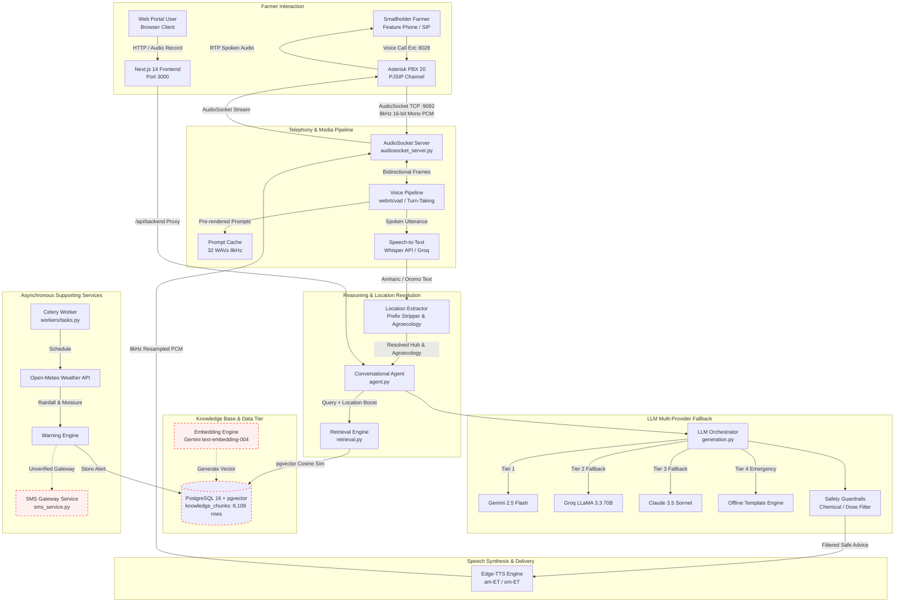

# Hello Farmer: Architecture Review & System Design Audit

**Audit Date:** October 2026  
**Audited Target:** `Hello_farmer` Multi-Service Architecture  

---

## 1. Actual Technology Stack & Versions

| Layer | Technology | Version | Role in System |
| :--- | :--- | :--- | :--- |
| **Telephony PBX** | Asterisk | 20.5.0 (Docker Alpine) | SIP signaling, PJSIP channel driver, AudioSocket bridge |
| **Media Transport** | AudioSocket | Custom TCP Protocol | Bidirectional raw 8kHz PCM streaming over port 9092 |
| **Backend API** | FastAPI / Python | 3.11 / FastAPI 0.110.0 | REST API, session orchestration, AudioSocket server |
| **Asynchronous Worker**| Celery / Redis | 5.3.6 / Redis 7.2 | Background weather alerts, document embedding, scheduled jobs |
| **Database & Vector** | PostgreSQL / pgvector| PG 16 / pgvector 0.7.0 | Relational schema + 768-dim embeddings (`vector(768)`) |
| **Speech-to-Text (STT)**| OpenAI Whisper / Groq | Whisper API / Local Base | Amharic/Oromo audio transcription |
| **Text-to-Speech (TTS)**| Edge-TTS / Pre-cached | Microsoft Edge TTS | Neural speech synthesis (`am-ET-MekdesNeural`, `om-ET`) |
| **LLM Inference** | Gemini / Groq / Claude| Gemini 2.5 Flash / LLaMA 3.3 | RAG generation, conversational dialog management |
| **Web Frontend** | Next.js / React | 14.1.0 / React 18 | Multi-tab agricultural dashboard, audio monitor, admin views |
| **Containerization** | Docker Compose | Compose v2 | 6 isolated services on internal bridge network `farmer_net` |

---

## 2. Repository Structure & Critical Entry Points

```
Hello_farmer/
├── asterisk/                   # PBX Telephony Configs
│   ├── extensions.conf         # Dialplan routing 8028 -> AudioSocket:9092
│   ├── pjsip.conf              # Extensions 1001, 1002, transport configs
│   └── Dockerfile              # Alpine Asterisk with res_pjsip & app_audiosocket
├── backend/
│   ├── app/
│   │   ├── main.py             # FastAPI entry point & route definitions
│   │   ├── config.py           # Pydantic Settings & environment validation
│   │   ├── models/             # SQLAlchemy ORM models (Farmer, Call, Chunk, etc.)
│   │   ├── rag/                # RAG pipeline, agent reasoning, embeddings
│   │   │   ├── agent.py        # Conversational dialogue agent & system prompt
│   │   │   ├── embed.py        # Text embeddings (Gemini + fallback)
│   │   │   ├── retrieval.py    # Vector search & location-weighted re-ranking
│   │   │   └── safety_checker.py # Chemical dosage & veterinary guardrails
│   │   ├── speech/             # Telephony, AudioSocket & Voice Pipeline
│   │   │   ├── audiosocket_server.py # Asyncio TCP server for 8kHz audio
│   │   │   ├── voice_pipeline.py    # VAD, turn-taking, STT/TTS coordination
│   │   │   ├── location_extractor.py # Geocoding & agroecology resolution
│   │   │   └── recording_policy.py  # Transient memory audio discard policy
│   │   └── services/           # External weather, warning & SMS services
│   └── cache/prompts/          # 32 Pre-rendered 8kHz mono WAV audio prompts
├── frontend/
│   ├── app/
│   │   ├── page.tsx            # Monolithic client component (179 KB)
│   │   └── api/backend/        # Reverse-proxy to FastAPI backend
│   └── public/                 # Static assets, branding & icons
├── scripts/
│   ├── ingest_documents.py     # Document parser & vector DB loader
│   ├── prebake_prompts.py      # Batch Edge-TTS audio generator
│   └── verify_voice_agent.py   # Telephony & AudioSocket diagnostic tester
└── docker-compose.yml          # Container orchestration (6 services)
```

---

## 3. End-to-End System Architecture Diagram



*Note: Dashed red borders indicate unverified, mocked, or compromised subsystems.*

---

## 4. End-to-End Data Flow Details

### 4.1 Telephony Inbound Call Flow
1. **Call Setup:** A farmer dials `8028` from a SIP client or PSTN trunk. Asterisk executes `Dialplan` rule in `asterisk/extensions.conf`, spawning `AudioSocket(0.0.0.0:9092/<UUID>)`.
2. **Immediate Greeting:** The AudioSocket TCP server establishes connection, immediately streaming `backend/cache/prompts/am_greeting.wav` (pre-rendered 8kHz mono PCM). No LLM or TTS latency is incurred during the first 2 seconds.
3. **Turn-Taking & VAD:** The caller responds. `backend/app/speech/voice_pipeline.py` feeds 320-byte chunks to `webrtcvad`. Upon 800ms of sustained silence after speech, turn capture concludes.
4. **Transcription:** Audio is upsampled to 16kHz and sent to Whisper. Resulting Amharic text is received.
5. **Location Extraction:** `backend/app/speech/location_extractor.py` scans for Ethiopian localities, normalizes conversational affixes (*"ከደብረ ብርሃን መጣሁ"* -> *Debre Birhan*), and attaches agroecological metadata (Highland / Dega, 2,840m elevation).
6. **RAG Retrieval:** `backend/app/rag/retrieval.py` executes vector similarity against PostgreSQL `knowledge_chunks` and calculates a Python-level keyword bonus (+0.20 for locality, +0.12 for region, +0.08 for agroecological zone).
7. **LLM Generation & Safety Filter:** System prompts ground the LLM in retrieved chunks, user location, and agroecology. The generated text is passed through `safety_checker.py` to strip unauthorized chemical dosages.
8. **TTS & Audio Playback:** Text is synthesized via Edge TTS (`am-ET-MekdesNeural`), downsampled to 8kHz 16-bit mono PCM via `scipy.signal.resample_poly`, and streamed back via AudioSocket to Asterisk.
9. **Post-Call Background Task:** A Celery task extracts an advisory summary and writes an SMS record to `sms_messages`.

---

## 5. Architectural Strengths

1. **Pre-Rendered Audio Caching:** By compiling 32 standard telephony prompts into 8kHz WAV files, the system circumvents TTS latency during critical initial interactions.
2. **AudioSocket Over SIP Directly in Python:** Using Asterisk's `app_audiosocket` avoids running heavy SIP/RTP stack libraries in Python, isolating SIP signaling in Asterisk while keeping raw PCM streams in asyncio.
3. **Strict In-Memory Audio Discarding:** Voice frames are processed as transient 20ms buffers in RAM and dropped immediately after transcription, satisfying strict caller privacy policies.
4. **Multi-Tier Model Resilience:** The 4-stage LLM fallback guarantees that OpenAI/Gemini rate limits or quota drops will not sever the conversational voice flow.
5. **Agroecology-Aware Location Modeling:** Rather than treating location as a mere string, the system models Ethiopian farming zones (elevation, frost vulnerability, rainfall patterns).

---

## 6. Architectural Weaknesses & Technical Debt

1. **Missing Vector Search Index (pgvector):**  
   `knowledge_chunks.embedding` operates without an HNSW index. Every query triggers a linear sequential scan over all 8,109 high-dimensional vectors, guaranteeing database CPU saturation under concurrent caller load.
2. **Client Monolith Frontend:**  
   `frontend/app/page.tsx` is 179 KB in a single file without modular components, making code maintenance and performance profiling fragile.
3. **Unauthenticated Multi-Tenant Endpoints:**  
   `GET /api/v1/farmer/profile` has no session or identity binding and returns an arbitrary record from the database.
4. **Data Redundancy in DB Schema:**  
   98.6% of chunks have `region = 'Ethiopia'`, nullifying the relational column's utility and forcing retrieval to resort to regex parsing inside chunk text.
